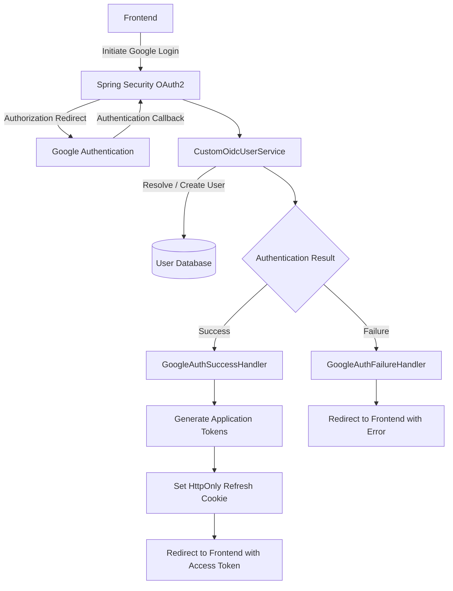

# 🔐 Google OAuth2 / OIDC Authentication

> **Architecture Documentation**
>
> Backend: Spring Boot + Spring Security  
> Authentication Provider: Google  
> Protocol: OAuth 2.0 + OpenID Connect (OIDC)  
> Application Authentication: JWT + Refresh Token

---

## 1. Architecture Overview

The application uses Google OAuth2 / OIDC for user authentication.

- Google is responsible for authenticating the user's identity.
- Spring Security manages the OAuth2/OIDC authentication flow.
- The application resolves or creates its own user account.
- The backend generates its own Access Token and Refresh Token.

---

## 2. Authentication Flow



---

## 3. Component Responsibilities

| Component | Responsibility |
|---|---|
| **Frontend** | Initiates Google login |
| **Spring Security OAuth2** | Manages OAuth2/OIDC protocol |
| **Google** | Authenticates the user's identity |
| **CustomOidcUserService** | Resolves or creates the application user |
| **User Database** | Stores users and authentication provider mappings |
| **GoogleAuthSuccessHandler** | Generates application tokens and redirects to frontend |
| **GoogleAuthFailureHandler** | Handles authentication failures |

---

## 4. OAuth2 Endpoints

Spring Security automatically provides these endpoints through OAuth2 Client configuration.

| Endpoint | HTTP Method | Purpose |
|---|---|---|
| `/oauth2/authorization/google` | GET | Initiates Google authentication |
| `/login/oauth2/code/google` | GET | Handles Google's authentication callback |

### Authentication Initiation

The frontend redirects the browser to:

```http
GET /oauth2/authorization/google
```

Spring Security constructs the authorization request and redirects the browser to Google.

### Authentication Callback

After successful authentication, Google redirects the browser to:

```http
GET /login/oauth2/code/google?code=...&state=...
```

Spring Security processes the callback and completes authentication.

---

## 5. User Resolution

`CustomOidcUserService` is responsible for resolving the authenticated Google identity to an application user.

```text
Google OIDC Identity
        |
        v
Extract Google Subject (sub)
        |
        v
Find GOOGLE Provider Mapping
        |
        +---- Existing Mapping ----> Load Application User
        |
        +---- No Mapping ----------> Find User by Verified Email
                                      |
                                      +---- Existing User
                                      |       |
                                      |       v
                                      |   Link Google Provider
                                      |
                                      +---- New User
                                              |
                                              v
                                         Create User
                                         Link Provider
```

**Important:** Google's `sub` is used as the unique provider identifier, not the email address.

---

## 6. Application Token Generation

After successful Google authentication, `GoogleAuthSuccessHandler` generates application-specific tokens.

| Token | Purpose | Delivery Mechanism |
|---|---|---|
| Access Token | Authenticates API requests | Frontend receives it in URL fragment |
| Refresh Token | Generates new access tokens | HttpOnly cookie |

### Success Response Flow

```text
GoogleAuthSuccessHandler
        |
        v
Generate Access JWT
        |
        v
Generate Refresh Token
        |
        v
Set Refresh Token as HttpOnly Cookie
        |
        v
Redirect to Frontend
        |
        v
/oauth2/callback#accessToken=<JWT>
```

### Failure Response Flow

```text
GoogleAuthFailureHandler
        |
        v
Authentication Failure
        |
        v
Redirect to Frontend
        |
        v
/oauth2/callback?error=google_authentication_failed
```

---

## 7. Security Responsibilities

| Security Concern | Implementation |
|---|---|
| OAuth state validation | Spring Security |
| Authorization code exchange | Spring Security |
| Google ID token validation | Spring Security OIDC |
| Google identity resolution | CustomOidcUserService |
| Application access token | JWT |
| Refresh token protection | HttpOnly Cookie |
| API authentication | JWT Resource Server |
| Disabled account validation | Application user validation |

---

## 8. Final Architecture

The authentication responsibility is divided into three layers:

1. **Google:** Identity authentication.
2. **Spring Security:** OAuth2/OIDC protocol management.
3. **Application:** User management, authorization, JWT generation and refresh-token management.

> **Key Takeaway:** Google authenticates the identity, Spring Security manages the authentication protocol, and the application issues and manages its own authentication tokens.
