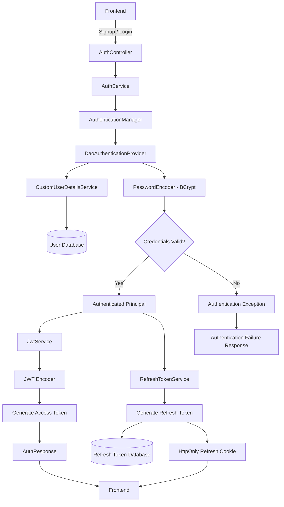
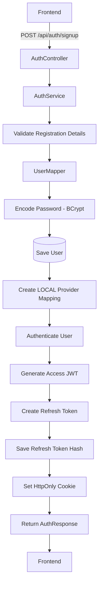
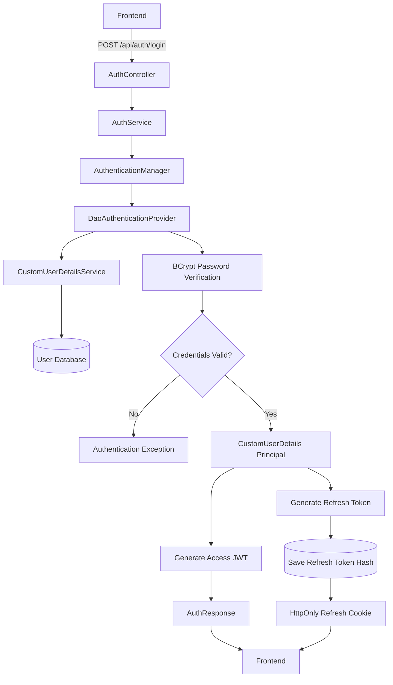
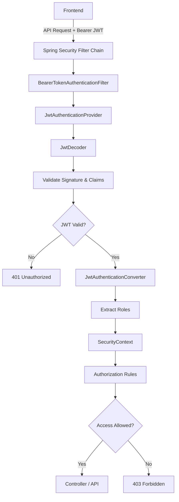
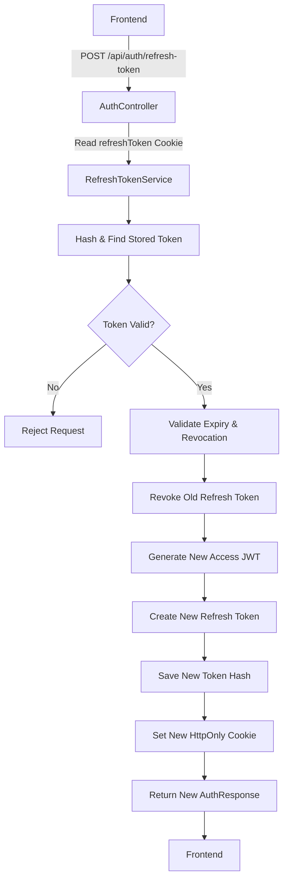

# 🔐 JWT Authentication & Authorization

> **Architecture Documentation**
>
> Backend: Spring Boot + Spring Security  
> Authentication: Username / Email + Password  
> Authorization: JWT (JSON Web Token)  
> Token Management: Access Token + Refresh Token  
> Password Encoding: BCrypt  
> Database: PostgreSQL

---

## 1. Architecture Overview

The application uses Spring Security with JWT-based authentication and authorization.

- Users authenticate using their username/email and password.
- Spring Security validates credentials through `DaoAuthenticationProvider`.
- The application generates a signed JWT Access Token.
- A Refresh Token is generated and stored securely in the database as a hash.
- The refresh token is delivered through an HttpOnly cookie.
- Protected API requests are authenticated using the JWT Resource Server.

---

## 2. Authentication Architecture



---

## 3. Component Responsibilities

| Component | Responsibility |
|---|---|
| **AuthController** | Exposes signup, login, refresh and logout endpoints |
| **AuthService** | Coordinates authentication and token generation |
| **AuthenticationManager** | Delegates authentication to the configured provider |
| **DaoAuthenticationProvider** | Validates user credentials |
| **CustomUserDetailsService** | Loads application user details |
| **PasswordEncoder** | Verifies BCrypt password hashes |
| **JwtService** | Generates application JWTs |
| **JwtEncoder** | Signs JWTs using the configured signing key |
| **RefreshTokenService** | Creates, validates and revokes refresh tokens |
| **RefreshTokenRepository** | Persists refresh-token hashes |
| **AuthCookieManagement** | Creates and clears refresh-token cookies |

---

## 4. Signup Flow



---

## 5. Login Flow



---

## 6. Access Token Generation

`JwtService` is responsible for generating the application's signed JWT.

### Token Claims

| Claim | Description |
|---|---|
| `iss` | Token issuer |
| `sub` | Application username |
| `iat` | Token issued-at timestamp |
| `exp` | Token expiration timestamp |
| `email` | User email |
| `roles` | User roles |

### Token Generation Flow

```text
Authenticated User
       |
       v
    JwtService
       |
       v
    JwtEncoder
       |
       v
  Build JWT Claims
       |
       v
  Sign using HS256
       |
       v
  Access JWT
```

The Access Token is returned in the `AuthResponse` body.

Example response:

```json
{
  "accessToken": "<access-token>",
  "tokenType": "Bearer",
  "user": {
    "id": 1,
    "username": "example"
  }
}
```

The refresh token is not included in the response body.

---

## 7. API Authorization Flow

The application uses Spring Security's OAuth2 Resource Server support to validate incoming JWTs.



### Responsibilities

| Component | Responsibility |
|---|---|
| **BearerTokenAuthenticationFilter** | Extracts Bearer JWT from Authorization header |
| **JwtAuthenticationProvider** | Coordinates JWT authentication |
| **JwtDecoder** | Validates JWT signature and claims |
| **JwtAuthenticationConverter** | Converts JWT roles into Spring authorities |
| **SecurityContext** | Holds authenticated user information |
| **Authorization Rules** | Checks endpoint access permissions |

### Example API Request

```http
GET /api/books
Authorization: Bearer <access-token>
```

For role-protected endpoints:

```java
.requestMatchers("/api/admin/**")
.hasRole("ADMIN")
```

---

## 8. Refresh Token Flow

When the Access Token expires, the frontend uses the refresh token cookie to obtain a new Access Token.



**Important:** The refresh token is rotated. The previous token is revoked and a new refresh token is issued.

---

## 9. Logout Flow

### Single Device Logout

```text
Frontend
   |
   v
POST /api/auth/logout
   |
   v
Read Refresh Token Cookie
   |
   v
RefreshTokenService
   |
   v
Revoke Refresh Token
   |
   v
Clear Refresh Token Cookie
   |
   v
Return Logout Response
```

### Logout From All Devices

```text
Frontend
   |
   v
POST /api/auth/logout-all
   |
   v
Get Authenticated Username
   |
   v
Revoke All Active Refresh Tokens
   |
   v
Clear Refresh Token Cookie
   |
   v
Return Logout Response
```

---

## 10. Token Management Strategy

| Property | Access Token | Refresh Token |
|---|---|---|
| Generated by | JwtService | RefreshTokenService |
| Format | JWT | Random opaque token |
| Storage | Frontend application memory | Database hash + HttpOnly cookie |
| Purpose | API authentication | Access token renewal |
| Validation | JwtDecoder | RefreshTokenService |
| Revocation | Expires naturally | Explicit revocation |
| Rotation | New token on refresh | Rotated on refresh |

---

## 11. Security Configuration

The API Security Filter Chain is configured with:

- Stateless session management.
- DaoAuthenticationProvider for LOCAL authentication.
- JWT Resource Server for API authentication.
- Custom JWT authentication converter for role extraction.
- Authentication entry point for unauthenticated requests.
- Access-denied handler for unauthorized access.
- Endpoint-specific authorization rules.

Example:

```java
.sessionManagement(session ->
    session.sessionCreationPolicy(
        SessionCreationPolicy.STATELESS
    )
)
.oauth2ResourceServer(oauth2 ->
    oauth2.jwt(jwt ->
        jwt.jwtAuthenticationConverter(
            jwtAuthenticationConverter
        )
    )
)
```

---

## 12. Final Architecture

The JWT authentication system is divided into three major responsibilities:

### 1. Authentication
Validates user credentials through Spring Security and `DaoAuthenticationProvider`.

### 2. Authorization
Validates Access JWTs through the JWT Resource Server and enforces role-based access.

### 3. Token Lifecycle Management
Manages Access Token generation, Refresh Token creation, rotation and revocation.

> **Key Takeaway:** Spring Security authenticates the user, JwtService issues the Access Token, the JWT Resource Server protects APIs, and RefreshTokenService manages the session renewal lifecycle.
